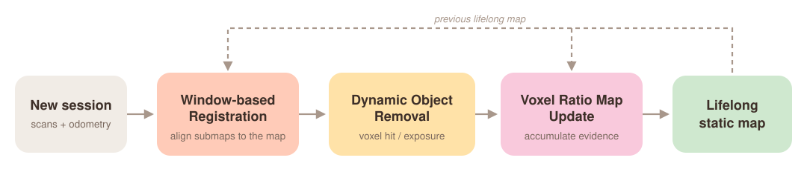
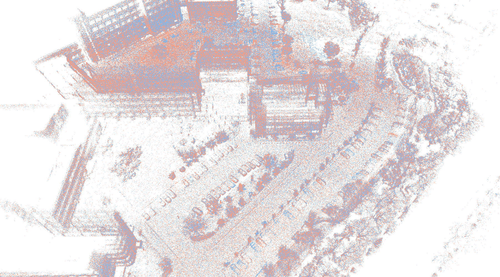
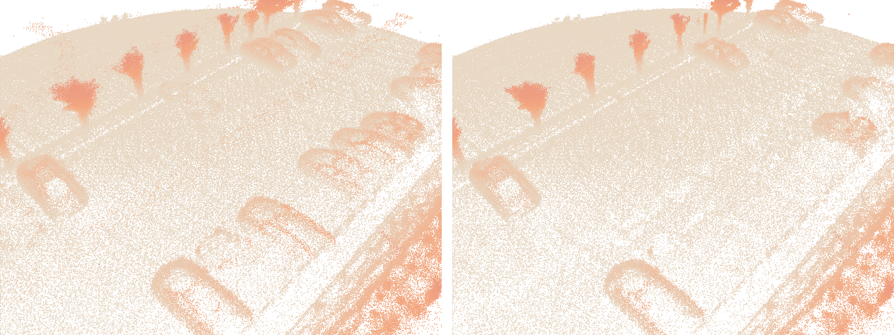

<h1 align="center">ELite++</h1>
<p align="center">
  <b>Efficient lifelong LiDAR mapping via window-based registration and Voxel Ratio Maps</b><br>
  an extension of <a href="https://github.com/dongjae0107/ELite">ELite</a> (ICRA 2025)
</p>

ELite++ keeps a clean static map over repeated LiDAR sessions. Each new session is aligned to
the current lifelong map without an initial guess, cleaned of dynamic objects with voxel
hit / exposure statistics, and merged into a compact Voxel Ratio Map that accumulates
evidence across sessions.

<p align="center">
  
</p>

| Stage | Idea | Code |
|---|---|---|
| Registration | Cut the new session into windows of consecutive scans, globally match each window to the previous map with [KISS-Matcher](https://github.com/MIT-SPARK/KISS-Matcher), trust windows with high fitness, interpolate the rest. | [`elitepp/registration.py`](elitepp/registration.py) |
| DOR statistics | Per voxel: hits (points inside) and exposure (rays passing through). Ground voxels from normal-based anchors. | [`elitepp/dor/stats.py`](elitepp/dor/stats.py) |
| DOR classification | Stability ratio R = hits / max(hits, exposure), refined by clustering, floating-fragment removal, ground columns, smoothing, bottom-residue removal and probabilistic recovery. | [`elitepp/dor/classify.py`](elitepp/dor/classify.py) |
| Integration | Statistics of all sessions are summed into one Voxel Ratio Map; previous lifelong points and new points are re-classified with it. | [`elitepp/voxel_map.py`](elitepp/voxel_map.py), [`elitepp/pipeline.py`](elitepp/pipeline.py) |

## Results on LT-ParkingLot (sessions 01 → 02)

**Registration.** Session 02 (coral) aligned onto the session-01 map (blue) without any initial transform.

<p align="center"></p>

**Lifelong map update.** A parking area before (left) and after (right) integrating session 02:
cars parked in session 01 that are gone in session 02 are removed from the map.

<p align="center"></p>

## Install

```bash
conda create -n elitepp python=3.12 -y
conda activate elitepp
pip install -e ".[viz,dev]"     # viz: rerun-sdk + viser, dev: pytest
```

A CUDA GPU is used for classification when available (CPU works, slower).

## Data

Each session is a directory in the SC-LIO-SAM / ELite format:

```
<dataset_dir>/<session>/
├── poses.txt          # KITTI format, one 3x4 pose per scan
└── Scans/
    ├── 000000.pcd     # scan in the sensor frame
    └── ...
```

The configs expect the LT-ParkingLot sessions under `../dataset/parkinglot/{01..06}`
(symlinks to the SC-LIO-SAM output; `poses.txt` → `optimized_poses.txt`).

## Run

```bash
elitepp-run configs/parkinglot.yaml            # all sessions in the config, in order
elitepp-run configs/parkinglot.yaml --rrd      # also write a Rerun recording per session
elitepp-run configs/parkinglot.yaml --force    # re-run sessions that already have outputs
```

The first session builds the base map; each next one is aligned to the previous lifelong map.

### Outputs

`<output_dir>/config.yaml` holds the fully resolved parameters. Per session `<output_dir>/<session>/`:

| File | Content |
|---|---|
| `aligned_poses.txt` | KITTI poses in the lifelong map frame |
| `session_map.pcd` | static points of this session |
| `session_vrm.npz` | voxel statistics of this session (`keys, hits, exps, grounds, voxel_size`) |
| `lifelong_map.pcd` | lifelong static map after this session |
| `lifelong_vrm.npz` | merged voxel statistics after this session |
| `debug.rrd` | Rerun recording (with `--rrd`) |

## Visualize

**Interactive viewer and DOR tuner (Viser)** — open the printed URL in a browser:

```bash
elitepp-view configs/parkinglot.yaml                      # last session, lifelong map
elitepp-view configs/parkinglot.yaml --session 02 --mode session
```

- points colored by the DOR stage that removed them, by stability ratio, or static only
- trajectories of all sessions
- every classification parameter as a slider / checkbox; changes re-classify the full map on
  the GPU in about 0.5 s
- save tuned parameters as YAML (`tuned_classify_<mode>.yaml`, paste into the config) and
  export the tuned static map

**Debug recordings (Rerun)** — what happened during a run, step by step:

```bash
rerun outputs/parkinglot/02/debug.rrd
```

| Entity | Shows |
|---|---|
| `registration/window` (timeline `window`) | each window under its candidate transform, green = trusted, red = rejected |
| `registration/log` | fitness per window |
| `trajectory/odometry`, `trajectory/aligned` | poses before / after registration |
| `map/previous` | the map the session was aligned to |
| `session/static`, `session/removed/<stage>` | session DOR result split by removal stage |
| `lifelong/...` | the same after integration |
| `*/voxel_ratio` | voxel stability, red (unstable) → amber → blue (stable) |

## Evaluate alignment

ELite protocol (nearest neighbors, 0.5 m inlier threshold): accuracy (AC), RMSE and Chamfer
distance (CD) between two session maps rebuilt from raw scans and any pose file:

```bash
elitepp-eval --src ../dataset/parkinglot/02 outputs/parkinglot/02/aligned_poses.txt \
             --tgt ../dataset/parkinglot/01 ../dataset/parkinglot/01/poses.txt
```

## Repository layout

Development guide and checks: [CONTRIBUTING.md](CONTRIBUTING.md).

```
elitepp/
├── pipeline.py         elitepp-run: session loop, file layout
├── registration.py     window-based registration
├── dor/                dynamic object removal
│   ├── params.py         StatsParams, ClassifyParams
│   ├── stats.py          hit / exposure / ground accumulation
│   └── classify.py       staged static / dynamic decision
├── voxel_map.py        Voxel Ratio Map (sorted int64 voxel codes)
├── evaluate.py         elitepp-eval
├── session.py          scan / pose / pcd I/O
└── viz/
    ├── viewer.py         elitepp-view (Viser)
    ├── rerun_logger.py   --rrd recordings
    └── style.py          shared colors
configs/                YAML configs
tests/                  pytest suite (synthetic data, < 10 s)
docs/                   parameters, implementation notes
assets/                 figures used in this README
```

## Citation

If you use ELite++, please cite:

```bibtex
@INPROCEEDINGS{lee-2026-iccas,
    author={Geonhui Lee and Hyeonjae Gil and Ayoung Kim and Minwoo Jung},
    title={ELite++: Efficient Lifelong LiDAR Mapping via Window-Based Registration and Voxel Ratio Maps},
    booktitle={Proceedings of the International Conference on Control, Automation and Systems (ICCAS)},
    year={2026},
}
```

ELite++ builds on ELite:

```bibtex
@INPROCEEDINGS{hjgil-2025-icra,
    author={Hyeonjae Gil and Dongjae Lee and Giseop Kim and Ayoung Kim},
    title={Ephemerality meets LiDAR-based Lifelong Mapping},
    booktitle={Proceedings of the IEEE International Conference on Robotics and Automation (ICRA)},
    year={2025},
}
```

## License

[MIT](LICENSE)
